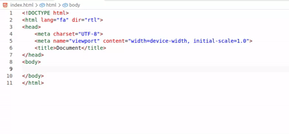

# LoremFA

VS Code extension that inserts Persian (Farsi) lorem ipsum text. Type an
abbreviation and press `Tab`:

| Abbreviation | Result |
| --- | --- |
| `loremfa` | One paragraph |
| `loremfa12` | 12 words |
| `loremfa*2` | Two paragraphs |

Persian digits work too (`loremfa۱۲`, `loremfa*۲`). Word counts are limited to
1000 and paragraph counts to 50.

Learn more at [loremfa.ir](https://loremfa.ir).

